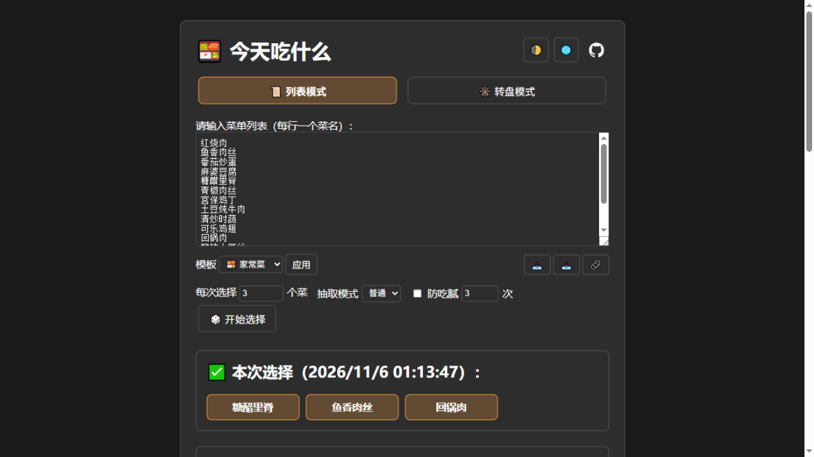
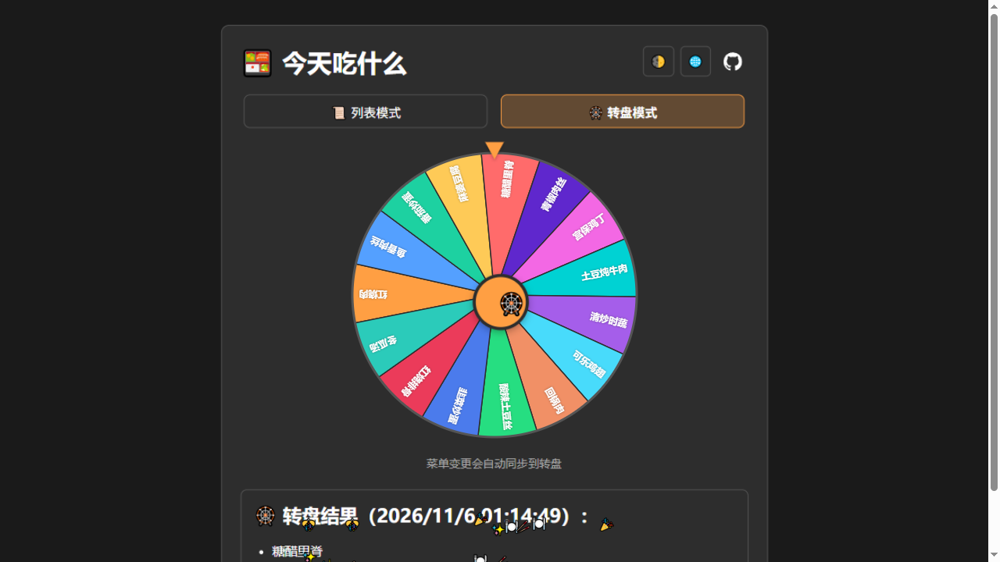

# 🍱 Random Menu Selector / 随机菜单选择器

[](https://github.com/ohto-ai/random_menu/actions/workflows/ci.yml)
[](https://github.com/ohto-ai/random_menu/actions/workflows/static.yml)
[](LICENSE)
[](#-pwa--离线安装)

一个简洁优雅的网页应用，通过从你的自定义菜单列表中随机选择菜品来帮助你决定吃什么。支持中英双语、转盘模式、多种抽取策略与 PWA 离线使用——纯前端、零依赖、零构建。

A simple, elegant web application that helps you decide what to eat by randomly selecting dishes from your custom menu list. Bilingual (Chinese/English), wheel mode, multiple pick strategies, and PWA offline support — pure frontend, zero dependencies, zero build step.

## ✨ Features / 功能特性

- **📜 列表模式 / List Mode**: 输入菜单列表，随机选出 N 个菜 / Enter your menu and randomly pick N dishes
- **🎡 转盘模式 / Wheel Mode**: Canvas 美食大转盘，转动动画 + 指针揭晓 / Canvas prize wheel with spin animation and pointer reveal
- **🎰 抽奖动画 / Slot Animation**: 结果以拉霸机方式滚动定格并撒花庆祝 / Results roll and settle like a slot machine, with celebration sparkles
- **🔁 三种抽取模式 / Three Pick Modes**: 普通（无重复）/ 排除（选过的移出候选）/ 统计（允许重复并累计）/ Normal (unique) / Elimination / Accumulate
- **⚖️ 防吃腻 / Anti-repeat**: 自动排除最近 N 次抽中的菜，避免连续吃同一道 / Exclude dishes picked in the last N rounds
- **📋 预设模板 / Templates**: 家常菜 / 外卖 / 饮品 / 零食一键应用 / Built-in menu templates one click away
- **📤 导入导出 / Import & Export**: 菜单以 txt 备份与恢复 / Back up and restore your menu as plain text
- **🔗 分享链接 / Share Link**: 菜单编码进 URL，复制链接给朋友即可共用 / Menu encoded in the URL — copy a link, share your menu
- **📊 统计面板 / Stats**: 各菜品累计被选次数排行 / Per-dish pick-count leaderboard
- **🕘 历史记录 / History**: 最近 20 次选择，可一键清空 / Last 20 selections with a clear button
- **🌐 双语支持 / Bilingual**: 自动语言检测 + 手动切换 / Auto language detection with manual toggle
- **🌙 暗黑模式 / Dark Mode**: 跟随系统偏好，支持三态手动切换 / Follows system preference with manual tri-state toggle
- **📱 响应式 / Responsive**: 桌面与移动端完美适配 / Works on desktop and mobile

## 🚀 Live Demo / 在线演示

Visit / 访问: [https://ohto-ai.github.io/random_menu/](https://ohto-ai.github.io/random_menu/)

## 📸 Screenshots / 截图展示

### 列表模式 / List Mode



### 转盘模式 / Wheel Mode



## 🛠 Usage / 使用方法

### 中文

1. **输入菜单**：在文本框中每行添加一个菜品，或从 📋 模板一键应用
2. **选择模式**：列表模式 / 转盘模式（页签切换）
3. **设置抽取策略**：每次数量、普通/排除/统计模式、防吃腻开关
4. **开始选择**：点击「🎲 开始选择」或转盘中心按钮
5. **查看统计与历史**：📊 统计面板查看口味排行，🕘 历史记录最近 20 次
6. **备份与分享**：📤 导出 txt / 📥 导入 txt / 🔗 复制分享链接

### English

1. **Enter your menu**: one dish per line, or apply a 📋 built-in template
2. **Choose a mode**: list mode / wheel mode (tabs)
3. **Configure picking**: dish count, normal/elimination/accumulate mode, anti-repeat toggle
4. **Start**: click "🎲 Start Selection" or the wheel's center button
5. **Review**: check 📊 stats and 🕘 recent history
6. **Backup & share**: 📤 export / 📥 import txt, 🔗 copy a share link

## 🎯 How It Works / 工作原理

### Pick Modes / 抽取模式

| 模式 / Mode        | 行为 / Behavior                                                                   |
| ------------------ | --------------------------------------------------------------------------------- |
| 普通 / Normal      | 一次抽出多个不重复的菜 / Draw several unique dishes at once                       |
| 排除 / Elimination | 每轮抽走一个并移出候选池，直到抽完 / Remove each winner from the pool until empty |
| 统计 / Accumulate  | 允许同轮重复选中，累计统计 / Repeats allowed, wins accumulate in stats            |

### Anti-repeat / 防吃腻

开启后，最近 N 轮抽中的菜会被排除；若候选不足则自动回退纯随机并给出提示。
When enabled, dishes picked in the last N rounds are excluded; if candidates run short, it falls back to pure random with a notice.

### Language Detection / 语言检测

- 浏览器语言以 `zh` 开头默认中文，以 `en` 开头或其他语言默认英文
- 可用 🌐 按钮手动切换，偏好保存在 localStorage
- Browser language starting with `zh` defaults to Chinese; `en` or others default to English. Toggle with the 🌐 button; preference is saved in localStorage.

## 💻 Tech / 技术细节

- **Frontend**: 纯 HTML5 + CSS3 + Vanilla JS（零依赖）/ Pure HTML5, CSS3 and vanilla JS (no dependencies)
- **Storage**: localStorage（菜单、历史、统计、偏好）/ localStorage for menu, history, stats and preferences
- **Wheel**: Canvas 2D 转盘组件 `js/wheel.js` / Canvas 2D wheel component
- **PWA**: manifest + Service Worker（静态资源 cache-first，HTML network-first）
- **Security**: 动态渲染全部使用 DOM API，不拼接用户输入 / All dynamic rendering uses DOM APIs — no user input in markup

## 📱 PWA / 离线安装

手机或桌面浏览器访问线上地址后，选择「添加到主屏幕 / Install App」即可离线使用。
Open the live site in a browser that supports PWA and choose "Add to Home Screen / Install" — the app works offline afterwards.

## 📁 Project Structure / 项目结构

```
random_menu/
├── index.html            # 页面结构 / page structure
├── css/style.css         # 样式 / styles
├── js/app.js             # 列表模式与全局逻辑 / list-mode & global logic
├── js/wheel.js           # Canvas 转盘组件 / canvas wheel component
├── sw.js                 # Service Worker
├── manifest.webmanifest  # PWA manifest
├── icons/                # 应用图标 / app icons
├── scripts/              # 开发辅助脚本 / dev helper scripts
└── .github/              # CI、Pages 部署与社区文件 / CI, Pages deploy, community files
```

## 💡 Local Development / 本地开发

环境要求 / Requirements: Node.js ≥ 18

```bash
git clone https://github.com/ohto-ai/random_menu.git
cd random_menu
npm install        # 安装开发依赖（仅 lint 工具）/ install dev deps (lint tooling only)
npm run serve      # http://localhost:8080
npm run lint       # ESLint + html-validate
npm run format     # Prettier
```

不安装依赖也可以直接用任意静态服务器打开本目录，或双击 `index.html`。
You can also open the folder with any static server — no install required.

## 🤝 Contributing / 贡献

欢迎贡献！请先阅读 [CONTRIBUTING.md](CONTRIBUTING.md)，通过 Issue 模板报告问题或建议。
Contributions are welcome! Please read [CONTRIBUTING.md](CONTRIBUTING.md) first, and use the issue templates for bugs and feature requests.

## 📄 License / 许可证

This project is open source and available under the [MIT License](LICENSE).

## 🙏 Acknowledgments / 致谢

- 灵感来自 [wheelofnames](https://wheelofnames.com)、[Picker Wheel](https://pickerwheel.com) 与 [美食大转盘](https://github.com/BaiTang520/meishi-wheel) 等同类工具
  Inspired by wheelofnames, Picker Wheel and other similar tools
- 图标：Emoji 与手绘便当盒 SVG / Icons: emoji and a hand-drawn bento SVG
- 初衷：解决「今天吃什么？」的日常纠结 / Inspired by the daily struggle of "what should I eat today?"

---

Made with ❤️ by [ohto-ai](https://github.com/ohto-ai)

_Helping people make food decisions, one random selection at a time!_

_让随机选择帮你解决今天吃什么的难题！_
